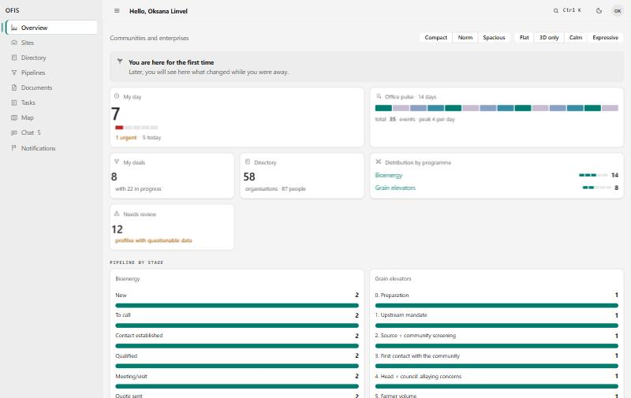

# Project Office CRM

[](../../actions/workflows/ci.yml)

Project Office CRM is a web platform for a small project office that develops **biogas plants** and
**grain-elevator projects** with Ukrainian communities: one place for counterparties, sites,
explainable site scoring, two deal pipelines with stage gates, documents, tasks, a map, a
team chat and an approval workflow.

This repository is a **public showcase**: the code of a system used in production, with every
piece of real data removed. The demo runs on synthetic data generated by `app/seed_demo.py`
(fictional companies, `*.example` e-mails, `99…` tax codes, the never-assigned `+380 00` phone range).



## Run it

```bash
docker compose up --build        # http://localhost:8030
```

Sign-in accounts and a 3-minute walkthrough are in [DEMO.md](DEMO.md). `docker compose down -v`
resets the demo database.

Without Docker (Python 3.12):

```bash
python -m venv .venv && . .venv/bin/activate
pip install -r requirements-dev.txt
OFIS_ENV=demo python -m app.seed_demo          # synthetic data, idempotent
OFIS_ENV=demo uvicorn app.main:app --port 8030
```

## What is inside

| Area | What it does |
|---|---|
| My day / overview | Per-role queue: overdue next actions, tasks, documents awaiting edits, data-quality debt, "what changed since you were here". |
| Directory | Counterparties and people with SQLite **FTS5** search, profile completeness, dedup on import (tax code, normalised names/phones). |
| Sites & hubs | Biogas sites and candidate communities. Every score is stored **decomposed into components** (`Score` + `ScoreComponent`) so "why is this site higher" always has an answer; unknown values are "no data", never zero. |
| Pipelines | Two programmes (bioenergy, grain elevators) with stages, **gates** (required, signed-off documents before a stage can be entered — including the final "won" stage) and an automatic transition rule; programmes and stages are data editable in the UI. |
| Documents | Versions, a workflow (draft → review → agreed → sent), letter templates with placeholders → DOCX; irreversible actions require explicit confirmation (HTTP 428). |
| Collaboration | Comments and recommendations on any card, approvals (**the author can never approve their own work**), assignments that can be accepted or declined with a reason, notifications, team feed. |
| Chat | Team room with mentions; any message becomes a task; legal import of WhatsApp chat exports into read-only archive rooms. |
| AI extraction | Deterministic extractor (no API key needed) with JSON-schema validation; **sums are re-computed by code**, a forged invoice total is flagged. An LLM provider can be switched on by configuration. |
| Map | Leaflet map of sites and hubs with filters and shareable views. |

## Security

Implemented in [`app/authkit.py`](app/authkit.py) (shared with the sibling [Grants portal](https://github.com/zvirmykhailo1987-cyber/hranty)) and
covered by tests:

- **Passwords**: argon2id; legacy `sha256(secret+password)` hashes are upgraded on first login.
- **Sessions**: server-side rows (only a SHA-256 of the cookie token is stored), absolute expiry
  and idle timeout, logout and "sign out everywhere" revoke them, session rotation on login.
- **CSRF**: double-submit token on every unsafe request plus an Origin/Referer check.
- **Login rate limiting**: 5 failures lock the (client IP, login) pair for 15 minutes; separate,
  higher thresholds per IP (30) and per login (50) stop spraying and distributed guessing without
  letting one client lock everybody out.
- **Request size limits**: an ASGI guard answers 413 before any form or upload is parsed
  (sign-in and CSP-report bodies are capped at 16 KB).
- **Cookies**: `Secure` + `__Host-` prefix in every environment except local development.
- **Headers**: strict CSP with per-request nonces (no `unsafe-inline`, no inline handlers or
  styles), CSP violation reporting, `frame-ancestors 'none'`, `nosniff`, `Referrer-Policy`,
  COOP/CORP, HSTS in production. OpenAPI docs are disabled outside local development.
- **Authorisation is deny-by-default on the route**: four roles with capabilities; a generated
  test walks the whole route table (anonymous → login, missing CSRF → 403, role without the
  capability → 403).
- The sign-in page lists no accounts; production refuses to start with development secrets.
- The Docker image runs as a non-root user with a read-only root filesystem.

## Quality gates

All run in CI ([`.github/workflows/ci.yml`](.github/workflows/ci.yml)):

| Gate | Tool |
|---|---|
| Lint | ruff (pyflakes, pycodestyle, bugbear, pyupgrade, flake8-bandit) |
| Types | mypy — strict on the security and i18n core; ORM query code with SQLModel-noise codes silenced (see `pyproject.toml`) |
| Tests | pytest — HTTP tests through the real stack, an every-screen crawl, access-boundary tests generated from the route table |
| Coverage | pytest-cov with branch coverage, `--cov-fail-under=95` (measured: 95.9% lines + branches; 97.4% of lines, 90.8% of branches) |
| Mutation check | `scripts/mutation_check.py` — **29 of 29 injected bugs caught**; CI checks every mutation still applies, the full run is local (results in [`docs/mutation-results.json`](docs/mutation-results.json)) |
| Dependencies | pip-audit |
| Static security | bandit |
| PII | `scripts/pii_scan.py` — pattern mode in CI; reference mode against the private production databases (read-only) is run by the maintainer before publishing |
| Container | image builds, `/health` answers, CSP header is served |

Current numbers are produced by a script, not typed by hand: `python scripts/metrics.py`.

**Mutation check.** Coverage says a line ran; the mutation check says a test fails when the line
is wrong. Each of the 29 mutations removes one guarantee from a temporary copy of the project —
a stage gate, the signed-document requirement, the HTTP 428 confirmation, a role check, a CSRF
check, session revocation and idle timeout, login lockout, private-archive visibility, the document
download roots, the zip-bomb limit, the importer's namesake guard, "no data is not zero" — and the
whole suite runs against it. A survivor means a missing test (add the test, never drop the mutation).
It takes about an hour, so it is run before publishing rather than on every push:

```bash
python scripts/mutation_check.py           # rewrites docs/mutation-results.json
python scripts/mutation_check.py --check   # seconds: every mutation still applies to the code
```

**Coverage exclusions.** There is no `# pragma: no cover` in the code. Two things are excluded in
`pyproject.toml`, each for a stated reason: `app/seed_demo.py` (writes the synthetic showcase data;
CI runs it before the PII scan) and `if __name__ == "__main__":` entry blocks (the functions they
call are tested directly).

## Internationalisation

The interface is English by default with Ukrainian as the second language (switch in the profile
menu or on the sign-in page). Source strings are Ukrainian (the team's working language); the
English catalogue is [`app/locale/en.json`](app/locale/en.json). A test crawls every screen in
English and fails on any untranslated string.

## Project layout

```
app/            FastAPI application (models, services, web routes, authkit, i18n)
templates_v2/   Jinja2 templates (one skin)
static/         design library (tokens, components, charts) + map scripts + vendored htmx/Leaflet
static_v2/      product layer: app shell CSS/JS, generated utility classes
tests/          pytest suite + acceptance criteria (`python -m tests.acceptance`)
scripts/        pii_scan.py, metrics.py, mutation_check.py
```

## Known limits

- SQLite and a single process: the login rate limiter is in-memory, the app is sized for a team,
  not for horizontal scaling.
- Identifiers in the code are transliterated Ukrainian (`voronky` = pipelines, `obyekty` = sites);
  comments explain intent in Ukrainian or English.
- Map infrastructure overlays (power lines, gas pipelines) used in production are not shipped: a
  public map of critical infrastructure is an OPSEC risk.
- Reports/exports/backups (a planned phase) are not part of this showcase.
- The login limiter lives in memory: lockouts and the list of clients that signed in before
  are lost on restart. A distributed guessing burst (50 failures for one login) locks that
  login for 15 minutes for every client that has not signed in to it before, including the
  owner on a new device.

## License

[MIT](LICENSE) © 2026 Mykhailo Zvir. Keep the copyright notice in copies and derived work.
